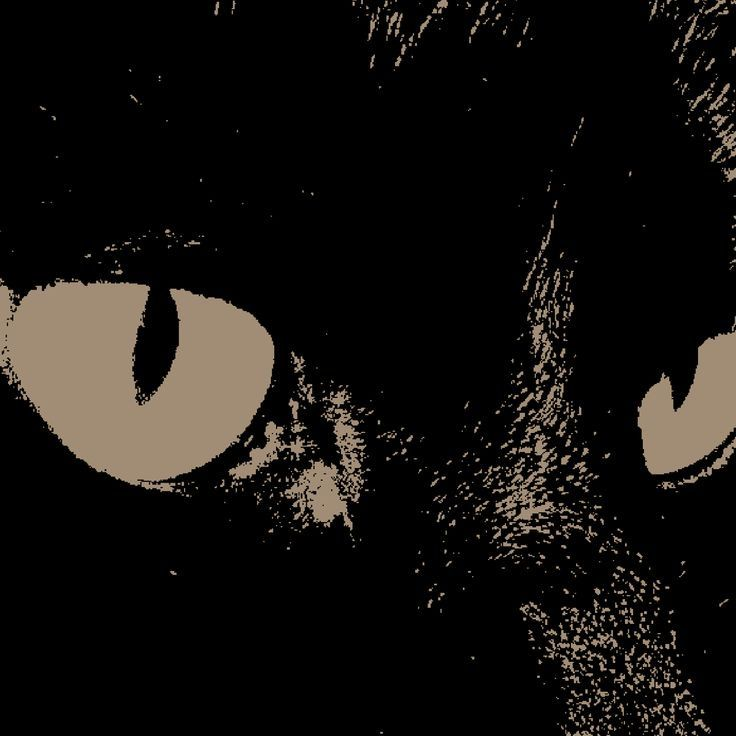
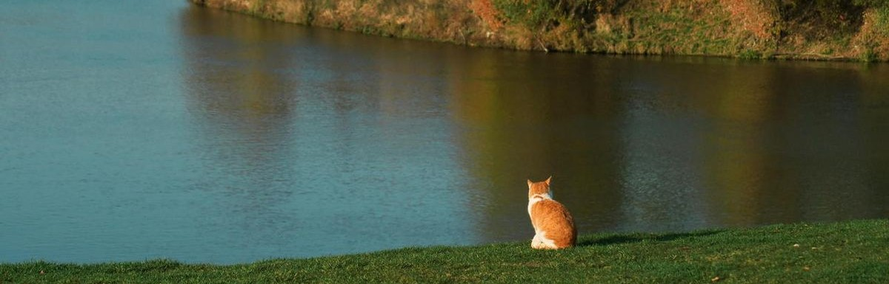

  

  

---

  
  <strong>Applied AI Engineer & Computer Engineering Student</strong>

  I build software and AI systems for problems that need both engineering and investigation. My work moves between applied machine learning research, LLM products and reliable backend systems.

  Currently studying Computer Engineering at PUC Goiás, with interests in AI applied to science, data-intensive systems and software that is useful outside a notebook.

 

  <h3>Technologies</h3>

---

 

  <h3>Selected projects</h3>

---

| Project | Focus |
| :--- | :--- |
| [**PMAssistant**](https://github.com/LucasPNunes1/PMAssistant-discord-rag-bot) | Discord FAQ bot with RAG, isolated memory and document search. |
| [**Controle de Embarcados**](https://github.com/LucasPNunes1/controle-embarcados) | Web interface that controls an ESP32 game through MQTT, NestJS and PostgreSQL. |
| **Hyperspectral Research** | Machine learning pipeline for bacterial resistance classification. Public version coming soon. |
| [**Cluster Beowulf**](https://github.com/LucasPNunes1/Projeto-Cluster-Beowulf) | C++ and OpenMPI project that distributes a search across simulated cluster nodes. |
| [**Processor Simulator**](https://github.com/LucasPNunes1/Simulador_De_Processador) | NASM and C simulator covering instructions, registers, memory and CPU operations. |

 

  <h3>Research</h3>

---

  Applied machine learning to hyperspectral images for bacterial resistance classification, with model comparison and leave-one-isolate-out validation across plates.

 

  <h3>Contribution map</h3>

---

  

Generated automatically with GitHub Profile 3D Contrib.

 

  

